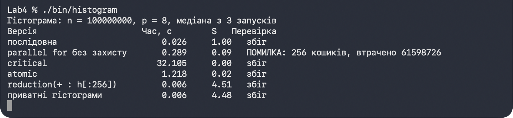
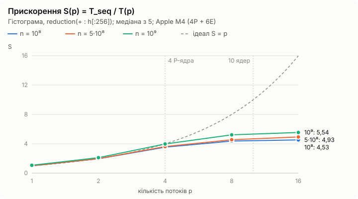
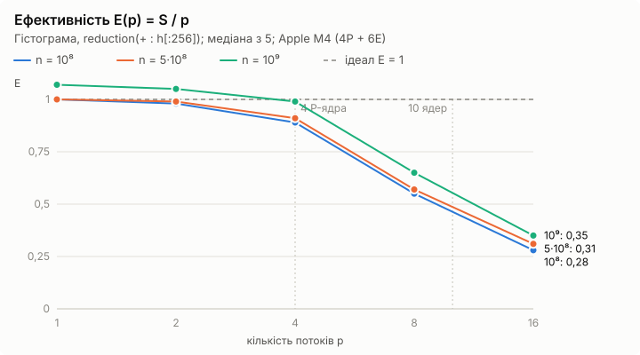
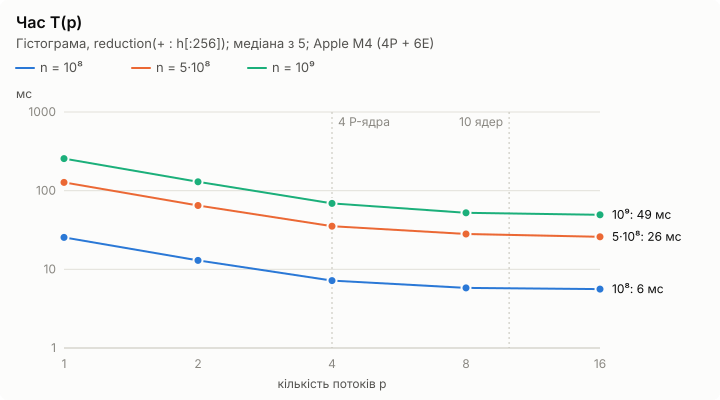

# Паралельна гістограма на C++ з OpenMP

Скільки разів у масиві зустрічається кожне значення 0…255? Задача проста, але має підступ: усі потоки пишуть у ті самі 256 кошиків. Без захисту губиться ~60 % значень, з `critical` програма стає в 1200 разів повільнішою за послідовну, і лише приватні гістограми (`reduction(+ : h[:256])`) дають справжнє прискорення.

Окрім гістограми, проєкт по кроках розбирає основи OpenMP: кількість потоків, клаузи видимості змінних, способи планування ітерацій (на підрахунку простих чисел, де ітерації нерівномірні), `sections`/`single`/`master`/`barrier`, і вимірює T(p), S(p), E(p) для трьох розмірів масиву.

C++17, OpenMP 4.5+, без сторонніх бібліотек.

## Як це працює

- **Дані** — масив `uint8_t` з n = 10⁸…10⁹ елементів, детерміновано згенерованих з номера елемента (хеш splitmix64): середнє двох випадкових байтів дає «трикутний» розподіл з піком біля 127.
- **Послідовна версія** `hist_seq` — еталон для перевірки і джерело T_seq.
- **Гонка** — `parallel for` зі спільними кошиками: `++h[a[i]]` неатомарна, частина інкрементів губиться.
- **Чотири виправлення:** `critical` (один замок на кожну ітерацію), `atomic` (апаратне атомарне додавання), `reduction(+ : h[:256])` і приватні гістограми зі злиттям у `critical` один раз на потік.
- **Перевірка коректності:** кожна паралельна версія порівнюється з послідовною по всіх 256 кошиках.
- **Методика вимірювань:** `omp_get_wtime()`, лише обчислення, прогрівальний запуск, потім медіана з 5 (у кроках 2 і 4 — з 3). S(p) рахується відносно послідовної версії, а не паралельної з одним потоком.

## Програми

| Програма | Що показує |
|---|---|
| `hello` | Номери потоків і три способи задати їх кількість: `OMP_NUM_THREADS` → `omp_set_num_threads()` → `num_threads` (за зростанням пріоритету) |
| `histogram` | Гонка на масиві кошиків і чотири способи її усунути, з часом кожного |
| `clauses` | `shared`, `private`, `firstprivate`, `lastprivate`: значення до, всередині і після області |
| `primes_schedule` | `static`, `static,k`, `dynamic`, `guided` на підрахунку простих чисел через `schedule(runtime)` |
| `stages` | Мінімум, максимум, середнє і гістограма як незалежні `sections`, плюс `single`, `barrier`, `master` |
| `bench` | T(p), S(p), E(p) для p = 1, 2, 4, 8, 16 і n = 10⁸, 5·10⁸, 10⁹ |

## Запуск

macOS (Apple clang + libomp):

```bash
brew install libomp
make
```

Linux / MinGW: у `Makefile` замініть `CXX` на `g++`, а `OMPFLAGS` на `-fopenmp`.

```bash
./bin/histogram race                                      # гонка: щоразу інша кількість втрачених значень
./bin/histogram                                           # усі версії: час, прискорення, перевірка
OMP_SCHEDULE=dynamic,1000 ./bin/primes_schedule           # один спосіб планування
./bin/primes_schedule all                                 # таблиця для шести способів
./bin/bench                                               # заміри для кроку 6
```



## Результати







<details>
<summary>Таблиці вимірювань</summary>

Apple M4 (4 продуктивні + 6 енергоефективних ядер, без гіперпотоковості), 16 ГБ, macOS 27, Apple clang 21 + libomp 23 (OpenMP 5.1), `-O2`.

**Гонка та її усунення**, n = 10⁸, p = 8:

| Версія | Час, с | S | Результат |
|---|--:|--:|---|
| послідовна | 0,026 | 1,00 | еталон |
| `parallel for` без захисту | 0,289 | 0,09 | втрачено 61,6 млн значень |
| `critical` | 32,105 | 0,0008 | правильно |
| `atomic` | 1,218 | 0,02 | правильно |
| `reduction(+ : h[:256])` | 0,006 | 4,51 | правильно |
| приватні гістограми + злиття | 0,006 | 4,48 | правильно |

**Гістограма з `reduction`**, T(p) у мс:

| p | n = 10⁸ | S | E | n = 5·10⁸ | S | E | n = 10⁹ | S | E |
|--:|--:|--:|--:|--:|--:|--:|--:|--:|--:|
| 1 | 25,5 | 1,00 | 1,00 | 127,2 | 1,00 | 1,00 | 255,9 | 1,07 | 1,07 |
| 2 | 13,0 | 1,96 | 0,98 | 64,8 | 1,97 | 0,99 | 129,5 | 2,11 | 1,05 |
| 4 | 7,2 | 3,54 | 0,89 | 35,3 | 3,62 | 0,91 | 68,8 | 3,97 | 0,99 |
| 8 | 5,8 | 4,37 | 0,55 | 28,1 | 4,55 | 0,57 | 52,3 | 5,22 | 0,65 |
| 16 | 5,6 | 4,53 | 0,28 | 25,9 | 4,93 | 0,31 | 49,3 | 5,54 | 0,35 |

T_seq: 25,5 / 127,8 / 273,1 мс.

**Способи планування**, прості числа до 2·10⁷, p = 8:

| schedule | Час, с | S(8) |
|---|--:|--:|
| послідовна | 2,934 | 1,00 |
| `static` | 0,733 | 4,00 |
| `static, 1000` | 0,681 | 4,31 |
| `static, 100000` | 0,818 | 3,59 |
| `dynamic, 1` | 0,850 | 3,45 |
| `dynamic, 1000` | 0,669 | 4,38 |
| `guided, 1000` | 0,656 | 4,47 |

Повний вивід усіх програм — у [results/output](results/output), таблиці — у [results](results), скріншоти — у [docs/screenshots](docs/screenshots).

</details>

## Висновки

- **Синхронізація в «гарячому» циклі вбиває прискорення.** `critical` на кожній ітерації — у 1200 разів повільніше за послідовну версію, `atomic` — у 47 разів. Навіть версія з гонкою повільніша за послідовну в 11 разів: ядра постійно пересилають одне одному рядки кешу з лічильниками.
- **Правильний шлях — приватні копії і одне злиття.** `reduction(+ : h[:256])` і ручні приватні гістограми однаково швидкі (S ≈ 4,5 на 8 потоках), бо в циклі немає жодної синхронізації.
- **До 4 потоків прискорення майже ідеальне** (E = 0,9–1,0), далі воно насичується на ≈ 5–5,5. Причина — неоднорідний процесор: у M4 лише 4 продуктивні ядра, а потоки на енергоефективних ядрах повільніші, і при `static` загальний час визначає найповільніший з них. 16 потоків на 10 ядрах майже нічого не додають.
- **Більший масив — краще прискорення:** для n = 10⁸ уся робота триває 5–6 мс, і помітну частку займають fork–join і злиття лічильників (послідовна частина за Амдалом).
- **Для нерівномірних ітерацій потрібне динамічне планування.** На простих числах `static` без порції дає дисбаланс, `dynamic, 1` — завеликі накладні витрати, а `dynamic`/`guided` з порцією 1000 найкращі; вони ж краще використовують ядра різної швидкості.

Та сама задача з простими числами на Java (`Thread` + `join`) — у репозиторії [parallel-prime-counting-java](https://github.com/EvelinaIvashchuk/parallel-prime-counting-java).

## Структура

```
Makefile                  збирання всіх програм
src/common.hpp            генерування даних, послідовна гістограма, допоміжні функції
src/hello.cpp             кількість потоків
src/histogram.cpp         гонка і чотири способи її усунення
src/clauses.cpp           клаузи видимості змінних
src/primes_schedule.cpp   способи планування
src/stages.cpp            sections, single, barrier, master
src/bench.cpp             заміри T(p), S(p), E(p)
results/                  таблиці вимірювань і вивід усіх програм
docs/                     графіки та скріншоти для README
```
